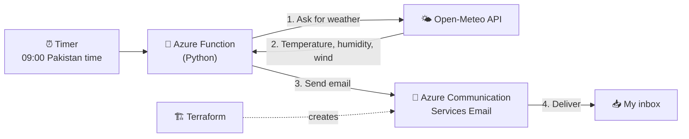
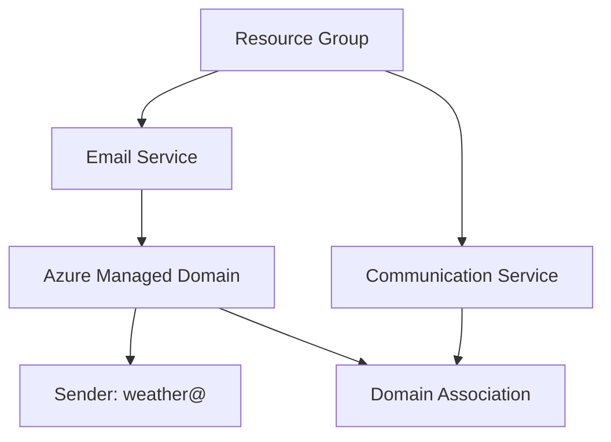

# Islamabad Weather Email: Project Explained

> **In one line:** Every day, a small Python program gets Islamabad's current weather and emails it to me. The program is an **Azure Function**, the email is sent by **Azure Communication Services**, and the Azure resources were created with **Terraform**.

**Result:** It works. I received the Islamabad weather email on **Wednesday, 11 Nov 2026** and again on **Thursday, 12 Nov 2026**.

---

## 1. The problem I solved

I wanted a daily weather report for Islamabad by email, without opening any app or website.

To do that I needed three things:

| Need | What I used |
|---|---|
| Weather data | **Open-Meteo API**: free, no API key needed |
| Code that runs on a daily schedule | **Azure Functions**, with a timer trigger |
| A way to send email | **Azure Communication Services (ACS) Email** |
| A repeatable way to create the Azure resources | **Terraform**: Infrastructure as Code |

---

## 2. How it works (the big picture)



**In simple steps:**
1. The **timer** fires every day at 09:00 Pakistan time.
2. The **Python function** calls the Open-Meteo API for Islamabad's coordinates.
3. It turns the reply into one readable sentence, for example:
   *"Weather in Islamabad: 24°C, Partly cloudy. Feels like 25°C; humidity 40%; wind 8 km/h."*
4. It gives that sentence to **ACS Email**, which sends it to my inbox.

**Terraform** is not part of the daily run. I used it once, beforehand, to **create** the email resources in Azure.

---

## 3. The files and what each one does

```
terraform-azure-weather/
├── main.tf                  ← Terraform: describes the Azure resources
├── .terraform.lock.hcl      ← Terraform: pins the exact provider version
├── terraform.tfstate        ← Terraform's memory of what it created (PRIVATE, not in git)
├── LEARNING_GUIDE.md        ← Progress tracker
├── PROJECT_EXPLAINED.md     ← This file
├── EVALUATION_QA.md         ← Likely evaluator questions and answers
└── function-app/
    ├── function_app.py      ← The timer function: gets the weather, sends the email
    ├── weather.py           ← Calls Open-Meteo and builds the weather sentence
    ├── requirements.txt     ← Python packages the function needs
    ├── host.json            ← Azure Functions runtime settings
    └── local.settings.json  ← Local settings (PRIVATE, not in git)
```

### `weather.py`: getting the weather
- Calls `https://api.open-meteo.com/v1/forecast` with Islamabad's **latitude 33.6844, longitude 73.0479**.
- Asks for the **current** temperature, "feels like" temperature, humidity, wind speed and weather code.
- Open-Meteo returns the weather as a **number code** (for example, `2`). The `WEATHER_DESCRIPTIONS` dictionary turns that code into words ("Partly cloudy").
- Uses only Python's built-in libraries (`urllib`, `json`), so it needs no extra packages.
- Has a **10-second timeout**, so the function doesn't hang if the API is slow.

### `function_app.py`: the scheduled job
- Uses the **Python v2 programming model**: the function is a normal Python function marked with a decorator, `@app.timer_trigger`.
- **Schedule:** `"0 0 4 * * *"`. This is a 6-part cron expression (second, minute, hour, day, month, weekday). Azure timers use **UTC**, and **04:00 UTC = 09:00 Pakistan time** (UTC+5).
- Steps inside the function:
  1. Gets the weather sentence from `weather.py`.
  2. Reads three settings from **environment variables**, not from the code:
     - `AZURE_COMMUNICATION_CONNECTION_STRING`: the "password" for ACS
     - `SENDER_EMAIL`: the `weather@...azurecomm.net` address
     - `RECIPIENT_EMAIL`: who receives the email
  3. If any setting is missing, it **stops with a clear error** instead of failing silently.
  4. Sends the email with `EmailClient.begin_send(...)` and **waits for the result**.
  5. If the status is not `"Succeeded"`, it raises an error. Otherwise it logs the operation ID.

### `requirements.txt`
- `azure-functions`: lets Python code run as an Azure Function.
- `azure-communication-email`: the official SDK for sending email through ACS.

### `main.tf`: the Terraform code
See the next section.

---

## 4. Terraform: what I built in Azure

Terraform lets me **describe** the infrastructure in a file. Terraform then creates it for me, instead of me clicking through the Azure portal.

All resources are in the **Central India** region, with data stored in **India**.

| # | Terraform resource | What it is, in simple words |
|---|---|---|
| 1 | `azurerm_resource_group` → `rg-islamabad-weather` | A **folder** in Azure that holds everything for this project. Deleting it removes everything. |
| 2 | `azurerm_email_communication_service` → `acs-email-islamabad-weather` | The **email service** itself. |
| 3 | `azurerm_email_communication_service_domain` → `AzureManagedDomain` | A free **email domain** provided by Azure (`<id>.azurecomm.net`), so I didn't need to buy and verify my own domain. |
| 4 | `azurerm_email_communication_service_domain_sender_username` → `weather` | The **sender name**, so mail comes from `weather@<id>.azurecomm.net` with the display name "Islamabad Weather". |
| 5 | `azurerm_communication_service` → `acs-islamabad-weather` | The main **Communication Services** resource. It provides the connection string my Python code uses. |
| 6 | `azurerm_communication_service_email_domain_association` | **Connects** the email domain (3) to the Communication Service (5). Without this link, sending fails. |

**Outputs**, the values Terraform prints after `apply`:
- `weather_sender_address`: the full sender email address, which I used as `SENDER_EMAIL`.
- `azure_subscription_selected`: shows `true` if an Azure subscription is selected. It shows this without printing the subscription ID.

**How resources depend on each other:** Terraform works out the order itself from the references. For example, the domain uses `azurerm_email_communication_service.weather.id`, so Terraform creates the email service first.



---

## 5. How I did it, step by step

### Step 1: Set up and log in
- Installed the Azure CLI, Terraform, Azure Functions Core Tools v4 and Python.
- `az login` signed me in to Azure. `az account show` confirmed the right subscription.
- Terraform's `azurerm` provider uses the Azure CLI login, so I didn't put any password in the Terraform code.

### Step 2: Built the weather code and tested it locally
- `func init` created the Python Functions project in `function-app/`.
- Wrote `weather.py` and the timer function.
- Started **Azurite**, the local Azure Storage emulator. Timer functions need storage to keep track of their schedule, and `local.settings.json` points to it with `UseDevelopmentStorage=true`.
- Ran `func start` and triggered the timer by hand. The **weather printed correctly in the logs**.

### Step 3: Created the email resources with Terraform
```powershell
terraform init      # download the azurerm provider
terraform plan      # preview what will be created
terraform apply     # create it in Azure
terraform output    # show the sender email address
```
- **Problem I hit:** the first `apply` failed because the `Microsoft.Communication` **resource provider was not registered** on my subscription. Azure subscriptions must "switch on" each service type before using it.
- **Fix:** registered it with `az provider register --namespace Microsoft.Communication`, then ran `terraform apply` again, and it succeeded.

### Step 4: Added email sending to the function
- Added `azure-communication-email` to `requirements.txt` and the sending code to `function_app.py`.

### Step 5: Sent a real email
- **Problem I hit:** the first send failed with an **invalid connection string** error.
- **Fix:** checked that the connection string had the right format (`endpoint=...;accesskey=...`). I also learned that environment variables set in PowerShell only exist **in that same PowerShell window**, so `func start` has to run in the window where I set them:
  ```powershell
  $env:AZURE_COMMUNICATION_CONNECTION_STRING = "<from Azure, never committed>"
  $env:SENDER_EMAIL    = "<terraform output weather_sender_address>"
  $env:RECIPIENT_EMAIL = "<my email>"
  func start
  ```
- **Result:** the email arrived ✅ (on Wednesday 11 Nov and Thursday 12 Nov 2026).

---

## 6. Security: how I kept secrets safe

- **No secrets in code.** The connection string and email addresses come from environment variables.
- **`.gitignore`** keeps private files out of git:
  - `terraform.tfstate` and its backup: Terraform state stores the ACS **access keys in plain text**
  - `.terraform/`: the downloaded provider, which is large and machine-specific
  - `local.settings.json`: local function settings
  - `.venv/`: the Python virtual environment
  - Azurite data files
- **`.terraform.lock.hcl` is kept in git.** It pins the provider version (azurerm 5.13.0), so everyone gets the same version.
- Never share connection strings, keys or the subscription ID.

---

## 7. Honest limitations and what I would do next

| Current state | Next improvement |
|---|---|
| The Function runs on **my laptop** (`func start`), so the email is only sent while it's running. | Add an **Azure Function App** (with a storage account and a Consumption plan) to Terraform, so it runs in the cloud 24/7. |
| Terraform state is a **local file**. | Store state remotely in an **Azure Storage backend**, which is safer and supports teamwork. |
| Secrets are entered by hand in PowerShell. | Store them in **Function App settings** or **Azure Key Vault**. |
| Values like names and region are written directly in `main.tf`. | Move them into a `variables.tf` with a `terraform.tfvars` file. |
| No automated deployment. | A **GitHub Actions** pipeline running `terraform plan`, `terraform apply` and the function deploy. |

---

## 8. Cost

- Open-Meteo is free.
- ACS Email charges a very small amount per email. One email a day costs almost nothing, and it comes out of the Azure Free Trial credit.
- To remove everything when finished: `terraform destroy`.
